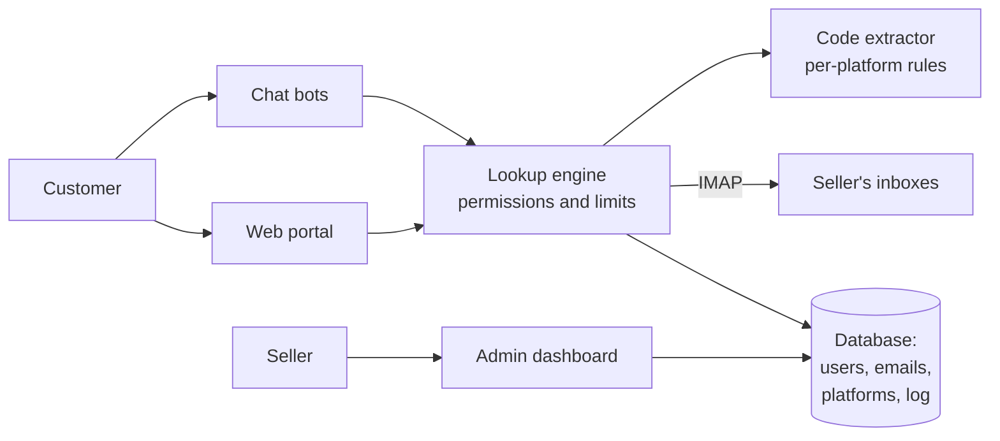

# CV5 · Verification code portal

> Your customer bought access to a digital service, and the service asks for a
> code sent to an inbox they don't control. CV5 shows them that code within
> seconds, only theirs, and never hands over the inbox password.

**Status:** in production ·
**Proprietary system** by Grupos Digitales ·
[Versión en español](README.md) ·
[Presentation page](https://rjblancos.github.io/cv5-showcase/) ·
**[Download the presentation as PDF](presentacion/CV5-presentacion.pdf)** (14 slides, in Spanish)

---

*The customer types their account's email and the platform, and CV5 shows the
code with the text of the notice. Demo store with made-up brands and data. The
interface is in Spanish.*

## The problem

Resellers of digital-service access run many accounts from a few inboxes. Every
time a service asks to verify a sign-in, the code lands in that inbox, and the
customer messages the seller to ask for it — at any hour, several times a day.

Sharing the inbox password is not an option: it exposes everything else.
Forwarding codes by hand doesn't scale.

CV5 sits in between as a portal under the seller's brand. The customer signs in
and asks for their code, and only sees notices for the email and platform
assigned to them.

## What it does

- **Codes within seconds.** It reads the inbox over IMAP, finds the latest
  notice for that platform and that email, and highlights the code. When the
  verification is a link, it shows a button that opens it.
- **Smart extraction.** Per-platform rules that tell the code apart from years,
  footers and other numbers in the email.
- **Fine-grained permissions.** Each customer only sees the authorized emails
  assigned to them, on the platforms and subjects they're allowed. If they look
  up someone else's, they get a notice and nothing is shown.
- **Authorized emails with owner and expiry date**, importable in bulk.
- **Several mail servers**, with a connection test from the dashboard.
- **Configurable platforms and subjects**, in several languages (Spanish,
  English, Portuguese, Arabic, Turkish, Dutch and Indonesian). 16 platforms come
  ready to use.
- **Chat bots.** Customers can ask for their code over chat, with the same
  rules, the same permissions and the same extractor as the web.
- **Real-time dashboard.** Searches, success rate, codes delivered and trends
  against the previous day and week, with a searchable log of every lookup.
- **The seller's brand.** Their own name, texts, links and contact.
- **Three-step installer and automatic schema updates** on every new version.

## Benefits

| For the seller | |
|---|---|
| **No more forwarding codes by hand** | Customers serve themselves, at any hour. |
| **Their inbox stays theirs** | Nobody else sees the password or the rest of the mail. |
| **Control over who sees what** | Email by email and platform by platform, with an expiry date. |
| **Knows how it's going** | How many lookups, how many found a code, and who looked up what. |

| For their customer | |
|---|---|
| **Their code right away** | No waiting for the seller to reply. |
| **From the web or from chat** | With the same result on both. |
| **Works on mobile** | Designed for small screens. |

## Screenshots

| Customer sign-in | Lookup without permission |
|---|---|
|  |  |

| Real-time dashboard | Authorized emails |
|---|---|
|  |  |

| Per-user permissions | Lookup log |
|---|---|
|  |  |

| Mail servers | On mobile |
|---|---|
|  |  |

Demo store: the platforms, emails and customers are made up.

## Architecture

The web and the bots share the same lookup engine and the same extractor, so the
customer gets the same answer whichever way they ask.

## Technical guarantees

| Area | What the system guarantees |
|---|---|
| **Privacy** | Nobody sees the inbox password. Every lookup checks on the server that the email and platform are assigned to the user. |
| **Security** | CSRF protection, session regenerated on sign-in, and limits on failed sign-ins and on rapid-fire lookups. |
| **Reliability** | If a mail server doesn't respond, the lookup carries on with the others and the failure is logged. A logging error never leaves the customer without an answer. |
| **Consistency** | Web and bots share the extractor, verified across the whole fleet with a harness of test emails. |
| **Design** | Checked from 360 to 1920 px: no overflow, no split words and every option in view. |

## Built with

| Language | Where | Approximate size |
|---|---|---|
| **PHP** | Portal, dashboard, lookup engine, extractor, bots, installer and migrations | 21,700 lines |
| **CSS** | The portal and dashboard interface | 1,800 lines |
| **SQL** | The schema | 120 lines |

GitHub's language bar only measures the files in this repository, which is
documentation.

## Results

Real figures from the installs in production, read on 27-Oct-2026:

- **More than 717,000 lookups** served since May 2025.
- **More than 466,000 codes delivered.**
- **More than 35,000 lookups** in the last 30 days.
- **860 users** and **2,300 authorized emails**.

## Want your own code portal?

We install it on your domain with your brand, your inboxes and your platforms,
and we keep it up to date.

Rafael Blanco, for Grupos Digitales

- Web: [gruposdigitales.com](https://gruposdigitales.com)
- Email: info@gruposdigitales.com
- WhatsApp: [+1 317 779 0136](https://wa.me/13177790136)
- Presentation: [14-slide PDF](presentacion/CV5-presentacion.pdf) (in Spanish)

© 2026 Grupos Digitales. See [LICENSE](LICENSE).
