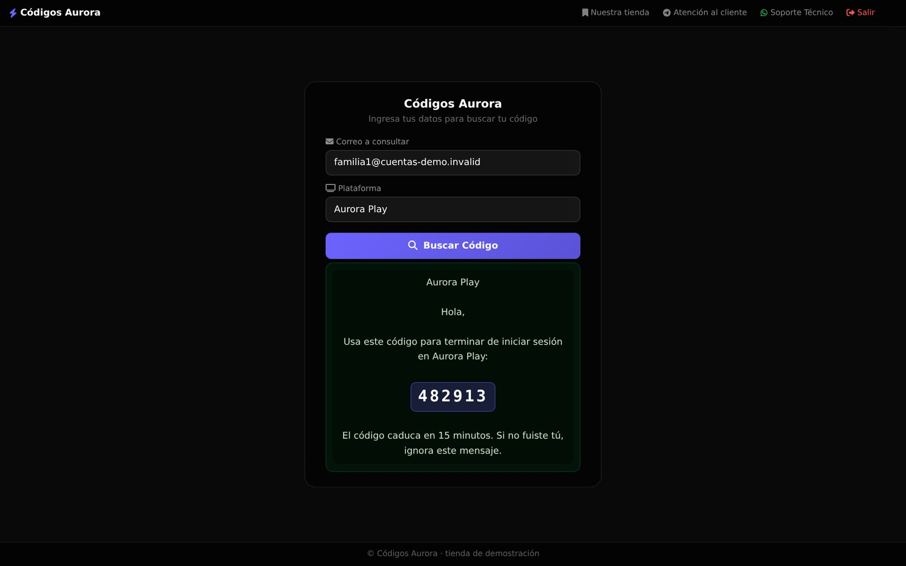
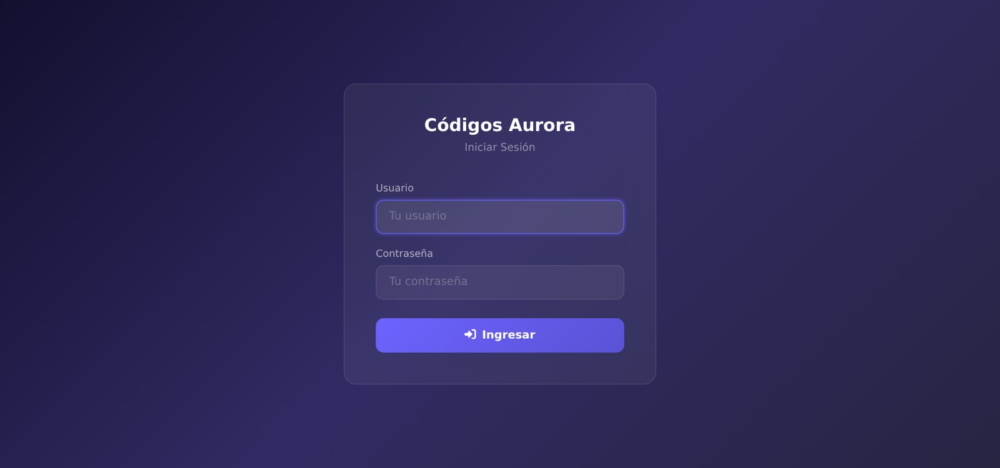
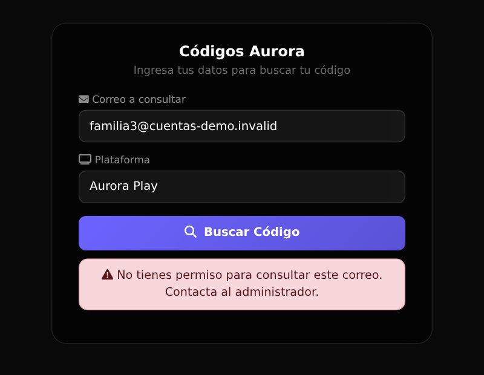
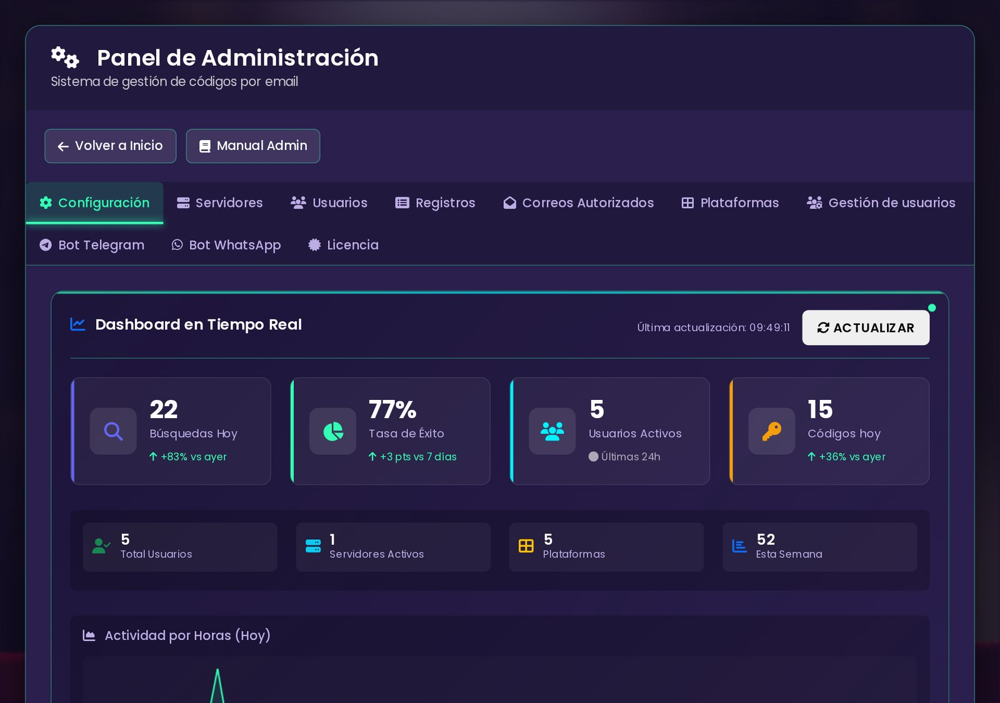
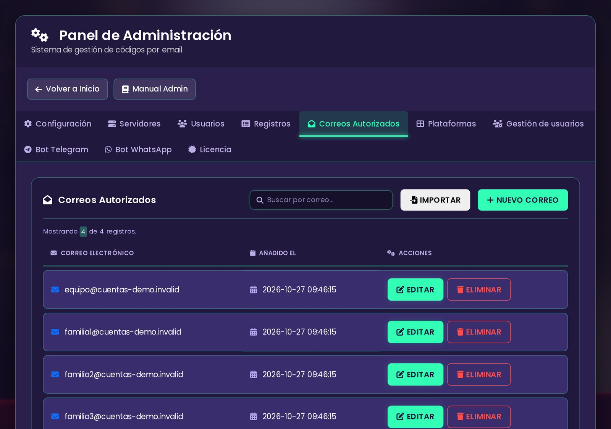
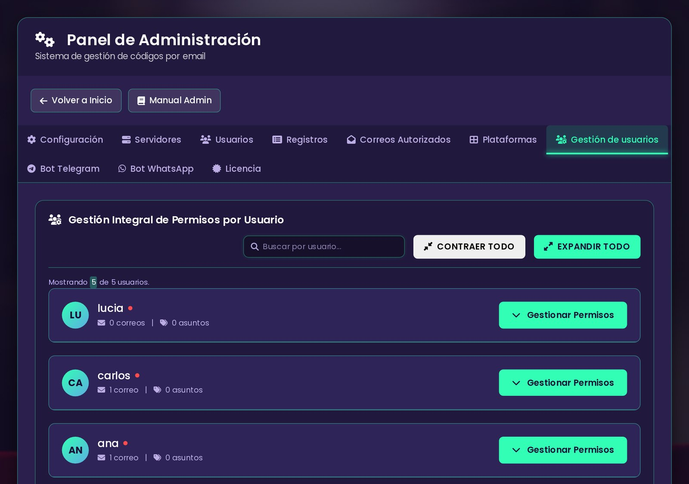
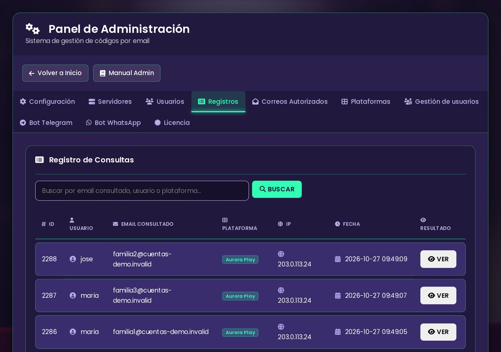
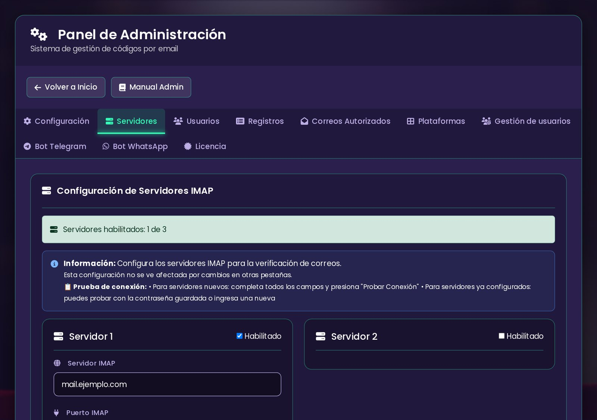
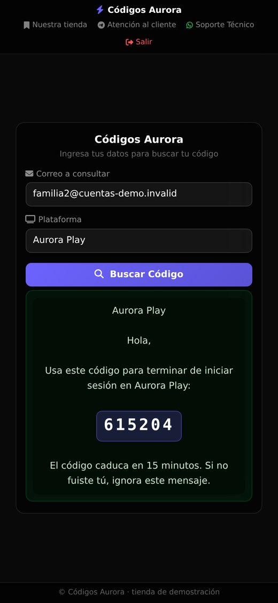
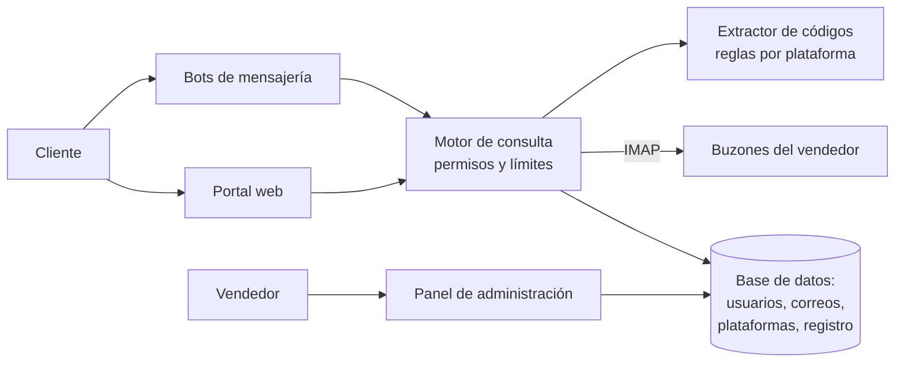

# CV5 · Portal de códigos de verificación

> Tu cliente compró acceso a un servicio digital, y el servicio le pide un código
> que llega a un correo que él no controla. CV5 le enseña ese código en
> segundos, solo el suyo y sin darle nunca la contraseña del correo.

**Estado:** en producción ·
**Sistema propietario** de Grupos Digitales ·
[English version](README.en.md) ·
[Página de presentación](https://rjblancos.github.io/cv5-showcase/) ·
**[Descargar la presentación en PDF](presentacion/CV5-presentacion.pdf)** (14 diapositivas)

---

*El cliente escribe el correo de su cuenta y la plataforma, y CV5 le muestra el
código con el texto del aviso. Tienda de demostración con marcas y datos
inventados.*

## Qué resuelve

Quien revende acceso a servicios digitales gestiona muchas cuentas desde unos
pocos buzones. Cada vez que un servicio pide verificar un inicio de sesión, el
código llega a ese buzón, y el cliente escribe al vendedor para pedirlo. A
cualquier hora y varias veces al día.

Dar la contraseña del buzón no es una opción: con ella se ve todo lo demás.
Reenviar códigos a mano no escala.

CV5 pone entre medias un portal con la marca del vendedor. El cliente entra y
pide su código, y solo ve los avisos del correo y de la plataforma que tiene
asignados.

## Qué hace

- **Consulta de códigos en segundos.** Lee el buzón por IMAP, encuentra el aviso
  más reciente de esa plataforma para ese correo y resalta el código. Cuando la
  verificación es un enlace, enseña un botón que lleva a él.
- **Extracción inteligente.** Reglas por plataforma que distinguen el código de
  los años, los pies de página y otros números del correo.
- **Permisos finos.** Cada cliente ve solo los correos autorizados que tiene
  asignados, en las plataformas y los asuntos que se le permiten. Si consulta
  uno ajeno, recibe un aviso y no se muestra nada.
- **Correos autorizados con titular y vencimiento**, que se importan en bloque.
- **Varios servidores de correo**, con prueba de conexión desde el panel.
- **Plataformas y asuntos configurables**, en varios idiomas (español, inglés,
  portugués, árabe, turco, neerlandés e indonesio). Trae 16 plataformas listas.
- **Bots de mensajería.** El cliente puede pedir su código por chat, con las
  mismas reglas, los mismos permisos y el mismo extractor que la web.
- **Panel en tiempo real.** Búsquedas, tasa de éxito, códigos entregados y
  tendencias frente al día y la semana anteriores, con registro de cada
  consulta y buscador.
- **Marca del vendedor.** Nombre, textos, enlaces y contacto propios.
- **Instalador en tres pasos y actualizaciones automáticas** del esquema al
  cambiar de versión.

## Beneficios

| Para el vendedor | |
|---|---|
| **Deja de reenviar códigos a mano** | El cliente se sirve solo, a cualquier hora. |
| **Su buzón sigue siendo suyo** | Nadie más ve la contraseña ni el resto de los correos. |
| **Controla quién ve qué** | Correo por correo y plataforma por plataforma, con fecha de vencimiento. |
| **Sabe cómo va** | Cuántas consultas, cuántas encontraron código y quién consultó qué. |

| Para su cliente | |
|---|---|
| **Su código al momento** | Sin esperar respuesta del vendedor. |
| **Desde la web o desde el chat** | Con el mismo resultado en los dos sitios. |
| **Funciona en el móvil** | Diseño pensado para pantallas pequeñas. |

## Capturas

| Entrada del cliente | Consulta sin permiso |
|---|---|
|  |  |

| Panel en tiempo real | Correos autorizados |
|---|---|
|  |  |

| Permisos por usuario | Registro de consultas |
|---|---|
|  |  |

| Servidores de correo | En el móvil |
|---|---|
|  |  |

Tienda de demostración: las plataformas, los correos y los clientes son
inventados.

## Arquitectura

La web y los bots usan el mismo motor de consulta y el mismo extractor. Así el
cliente obtiene la misma respuesta por cualquiera de los dos caminos.

## Garantías técnicas

| Área | Qué garantiza el sistema |
|---|---|
| **Privacidad** | Nadie ve la contraseña del buzón. Cada consulta comprueba en el servidor que el correo y la plataforma estén asignados al usuario. |
| **Seguridad** | Protección CSRF, sesión regenerada al entrar, límite de intentos fallidos de entrada y de consultas seguidas. |
| **Fiabilidad** | Si un servidor de correo no responde, la consulta sigue con los demás y el fallo se anota. Un error al registrar nunca deja al cliente sin respuesta. |
| **Coherencia** | Web y bots comparten el extractor, verificado en toda la flota con un arnés de correos de prueba. |
| **Diseño** | Comprobado de 360 a 1920 px: sin desbordes, sin palabras partidas y con todas las opciones a la vista. |

## Construido con

| Lenguaje | Dónde | Tamaño aproximado |
|---|---|---|
| **PHP** | Portal, panel, motor de consulta, extractor, bots, instalador y migraciones | 21.700 líneas |
| **CSS** | La interfaz del portal y del panel | 1.800 líneas |
| **SQL** | El esquema | 120 líneas |

La barra de lenguajes de GitHub mide solo los ficheros de este repositorio, que
es documentación.

## Resultados

Cifras reales de las instalaciones en producción, leídas el 27-oct-2026:

- **Más de 717.000 consultas** atendidas desde mayo de 2025.
- **Más de 466.000 códigos entregados.**
- **Más de 35.000 consultas** en los últimos 30 días.
- **860 usuarios** y **2.300 correos autorizados**.

## ¿Quieres tu portal de códigos?

Se compra directamente en la tienda de Grupos Digitales, en la categoría
**Sistemas Web**: [gruposdigitales.com/store/sistemas-web](https://gruposdigitales.com/store/sistemas-web). Lo
instalamos en tu dominio con tu marca, tus buzones y tus plataformas, y lo
mantenemos al día.

**Qué necesitas:** un hospedaje web y un dominio propio. Recomendamos un
hospedaje *DMCA ignored*, que no retira el sitio ante avisos de derechos de autor.

**Vídeos:** presentaciones y tutoriales del sistema en
[esta lista de YouTube](https://youtube.com/playlist?list=PLyDRJN_qrsyXe7OHqQV_w7kECBchg8sZR).

- Comprar: [gruposdigitales.com/store/sistemas-web](https://gruposdigitales.com/store/sistemas-web)
- Web: [gruposdigitales.com](https://gruposdigitales.com)
- Correo: info@gruposdigitales.com
- WhatsApp: [+1 317 779 0136](https://wa.me/13177790136)
- Vídeos: [lista de YouTube](https://youtube.com/playlist?list=PLyDRJN_qrsyXe7OHqQV_w7kECBchg8sZR)
- Presentación: [PDF de 14 diapositivas](presentacion/CV5-presentacion.pdf)

## Novedades

- **27-oct-2026** · Ya se puede comprar directamente en la tienda de Grupos Digitales, y hay una lista de vídeos con presentaciones y tutoriales.
- **27-oct-2026** · Publicación de la vitrina, con su presentación en PDF descargable.

Registro completo: [CHANGELOG.md](CHANGELOG.md).

© 2026 Grupos Digitales. Ver [LICENSE](LICENSE).
